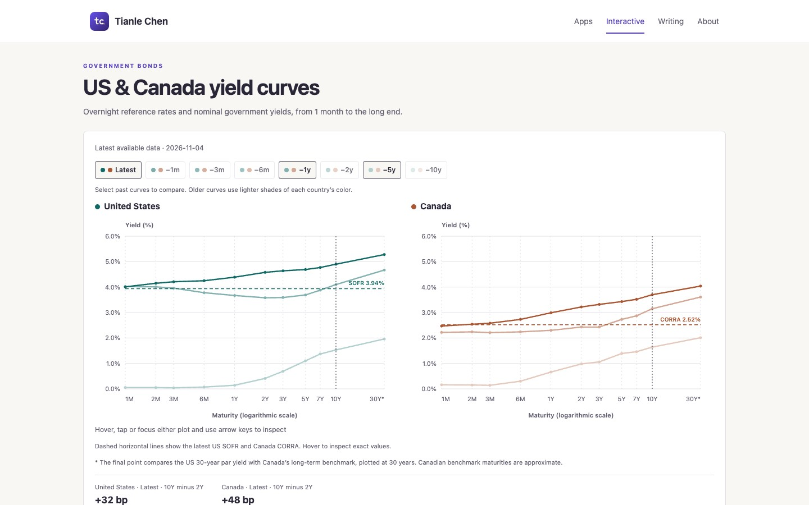
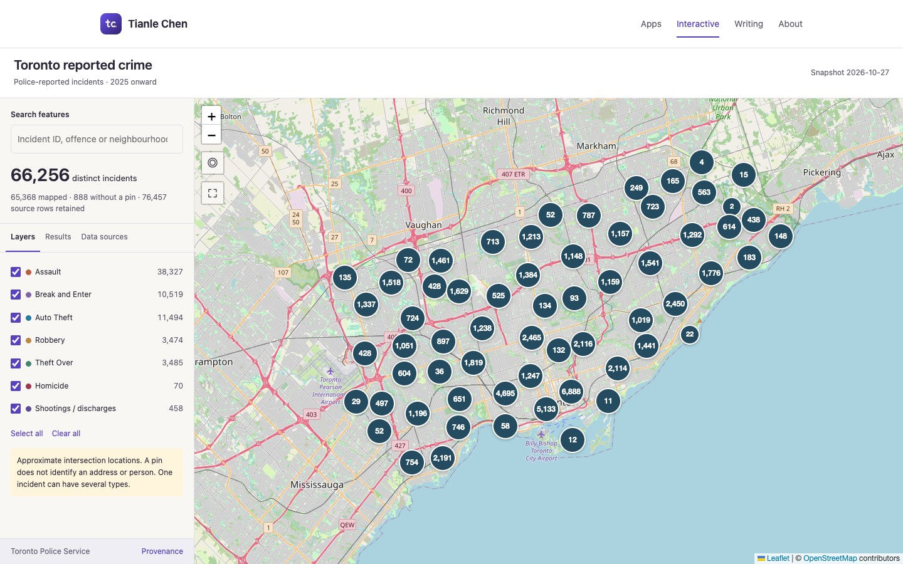

<section class="home-intro">
  
Apps · Maps · Writing

  <h1>Hi, I’m Tianle.</h1>
  
I build apps as tchdevs, explore data through interactive tools, and write about technology.

</section>

<section aria-labelledby="apps-title">
  
<h2 id="apps-title">Apps by tchdevs</h2><a href="/apps/">Explore the apps →</a>

  

    
    <article class="home-app">
      
      
<h3><a href="/apps/#{{ app.slug }}">{{ app.name }}</a></h3>
{{ app.summary }}

    </article>
    
  

</section>

<section id="interactive" aria-labelledby="interactive-title">
  
<h2 id="interactive-title">Interactive</h2><a href="/interactive/">All maps &amp; charts →</a>

  

    <article class="project-preview">
      
      <h3><a href="/StaticSites/us-canada-yield-curves/output/us-canada-yield-curves.html">US &amp; Canada yield curves</a></h3>
      
Compare government bond yields across maturities and historical dates.

    </article>
    <article class="project-preview">
      
      <h3><a href="/StaticSites/toronto-crime-map/output/toronto-crime-map.html">Toronto reported crime</a></h3>
      
Explore police-reported incidents by location and offence type.

    </article>
  

</section>



<section id="blog" aria-labelledby="writing-title">
  
<h2 id="writing-title">Recent writing</h2><a href="/writing/">All writing →</a>

  <ul class="writing-list">
    
    <li><time datetime="{{ post.date | date_to_xmlschema }}">{{ post.date | date: '%B %-d, %Y' }}</time><h3><a href="{{ post.url | relative_url }}">{{ post.title }}</a></h3></li>
    
  </ul>
</section>

